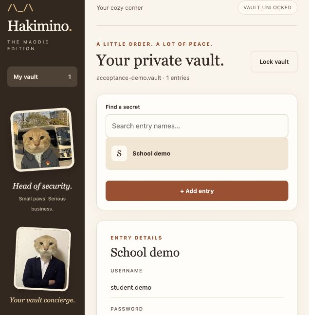
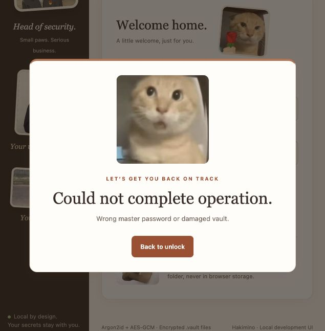

# Acceptance rehearsal — 11 November 2026

## Conclusion

**The tested technical workflows passed; no new delivery-blocking functional
defect was found in the exercised scope.** Two non-blocking browser polish
issues were found at this revision and subsequently fixed; see the
[follow-up verification](web-polish-2026-11-11.md). Native OS dialog usability on the actual acceptance computer is
not signed off: native application control timed out, so the desktop results
below are explicit Tk integration tests, not claims of human mouse operation.

This is an AI-assisted technical rehearsal for the planned 12 November 2026
acceptance, not instructor approval, proof of submission or a guarantee of a
perfect project. The complete course-site brief is still unavailable.

## Exact revision and environment

- Remote main and tested application: `666ead44ab8b60b61bb25f44f57a55b75589d6c2`.
- [Matching CI 43091653826](https://github.com/GastonRicheal/hakimino/actions/runs/43091653826):
  successful on Python 3.11 and 3.12; checked again before rehearsal.
- macOS 26.4 arm64, Python 3.12.14, Tk 9.0, Node 24.21.0.
- Fresh source exported with `git archive HEAD`, a new virtual environment, and
  non-editable `pip install ".[test]"`. No ignored build output or private vaults
  were copied into the test source.
- Tk and browser rehearsal used the previously clean-installed, byte-verified
  package for the same application revision, outside the source directory.
- All vaults, accounts and passwords were synthetic and kept outside the repository.
  No external accounts or personal vault files were tested.
- No application source was changed in this rehearsal. The script, report,
  evidence and updated handoff are delivered together with the later web-polish
  fix. The results below remain tied to the original rehearsal revision; the
  follow-up records its own tests rather than relabeling this historical evidence.

## Evidence by method

| Area | Observed result | Evidence / boundary |
| --- | --- | --- |
| Fresh installation | PASS | New venv and non-editable install from the exact Git archive |
| Full Python suite | 93 passed, 0 skipped, 69.94 s | [Log](evidence/rehearsal-2026-11-11/pytest.log); includes actual Tk widgets and stale-deletion regressions |
| Frontend regression suite | 18 passed, 0 skipped | [Log](evidence/rehearsal-2026-11-11/node.log); controlled minimal DOM, distinct from browser rehearsal |
| Dependency consistency | PASS | [pip check](evidence/rehearsal-2026-11-11/pip-check.log) |
| CLI end-to-end | 12 checks passed | [Report](evidence/rehearsal-2026-11-11/cli.log); real separate processes and POSIX PTYs, non-echoing prompts; not a Windows PTY test |
| Desktop create/generate/save/search | PASS | [Tk log](evidence/rehearsal-2026-11-11/desktop-rehearsal.log); native confirmation/save dialog responses supplied by test fixtures |
| Desktop default reveal timer | PASS at 15.61 s | Verified still revealed before 15 s and masked afterward; constants were not shortened |
| Desktop manual lock/wrong password/correct unlock | PASS | Fields cleared; failed authentication preserved file bytes |
| Desktop restart recovery | PASS | First process closed; a second desktop process reopened the saved record |
| Desktop five-minute idle lock | PASS at 301.52 s | Verified still unlocked at 299 s, then locked with fields cleared; no shortened timer |
| Desktop cancel/confirm deletion | PASS | Cancel preserved ciphertext; confirmed deletion persisted an empty collection |
| Tampered disposable copy | PASS | Authentication rejected; both original and modified copy remained unchanged by the failed open |
| Actual browser create/save/search | PASS | Separate loopback test server and browser UI; generated password saved and searched |
| Actual browser explicit reveal/hide | PASS | Reveal visible, masked when checked 18.26 s after request; not a claim of millisecond timer precision |
| Actual browser wrong-password/recovery | PASS | Error illustration and authentication error visible; correct unlock restored the same record |
| Native window clicking/dialog usability | NOT VERIFIED | Computer-control selection of the Python application timed out |
| Actual browser delete confirmation interaction | INCONCLUSIVE | Automation click timed out around the modal and no live dialog handle was returned; record remained; HTTP/DOM and Tk/CLI tests cover deletion separately |

The core and integration regressions include identical-content same-label
replacement, changes during confirmation, missing/stale revisions, preservation
of current ciphertext, fresh-view recovery and no stale web reveal. The existing
malicious-rollback and shared-web-session limitations remain documented.

## Findings and minimum remedies

### Resolved in follow-up: browser singular count

- Location: `hakimino/web/app.js`, line 29 at the tested revision.
- Trigger: exactly one saved entry.
- Observed text: “1 entries”.
- Impact: English presentation polish only; no storage or security impact.
- Minimum future fix: choose “entry” for one and “entries” otherwise, with a
  rendering assertion. Implemented and tested in the linked follow-up; the
  original rehearsal screenshots below intentionally remain historical.

### Resolved in follow-up: browser filename resets on lock/failure

- Location: `hakimino/web/app.js`, line 28 (`ui-test.vault` default).
- Trigger: lock or failed unlock of a differently named vault.
- Impact: the presenter must re-enter the intended filename; otherwise a later
  unlock may target the default name and fail. No observed data loss.
- Original workaround: use `ui-test.vault` or explicitly re-enter the filename.
  The follow-up removes this need within the same page lifetime.
- Minimum future fix: preserve only the last filename across locked renders;
  never retain the master passphrase. Implemented and tested in the linked
  follow-up, including failed unlocks, session expiry and HTML escaping.

### Documentation: earlier handoff emphasized the older PR #7 baseline

The previous top-level integrated-status section described `f2d6642` / 74 Python
and 13 frontend cases. A current-revision section has now been added,
with the old results kept explicitly historical. This avoids presenting old CI
counts as evidence for the stale-deletion fix.

## Remaining human checks

- Use the actual acceptance computer/projector: verify native creation/open/save
  dialogs, text size, minimum window size, keyboard focus and image rendering.
- Run the complete spoken script once with both presenters. Agree on timing and
  truthful contribution statements; do not infer ownership from speaking roles.
- Confirm all additional requirements in the full brief, exact deadline/timezone,
  required submission files, access permissions and the course submission receipt.
- Check course rules for AI assistance and third-party meme images. Educational
  use is not treated here as proof of an unrestricted image license.
- Restart old app/web processes after updating. Use synthetic data only.

## Presentation materials

Use [the English demonstration script](../DEMO_SCRIPT.md). The primary path is
the desktop and CLI; the local browser theme is an optional bonus. Do not quietly
replace an unverified native workflow with the browser and call them identical.

Masked browser evidence:

Wrong-password evidence:

