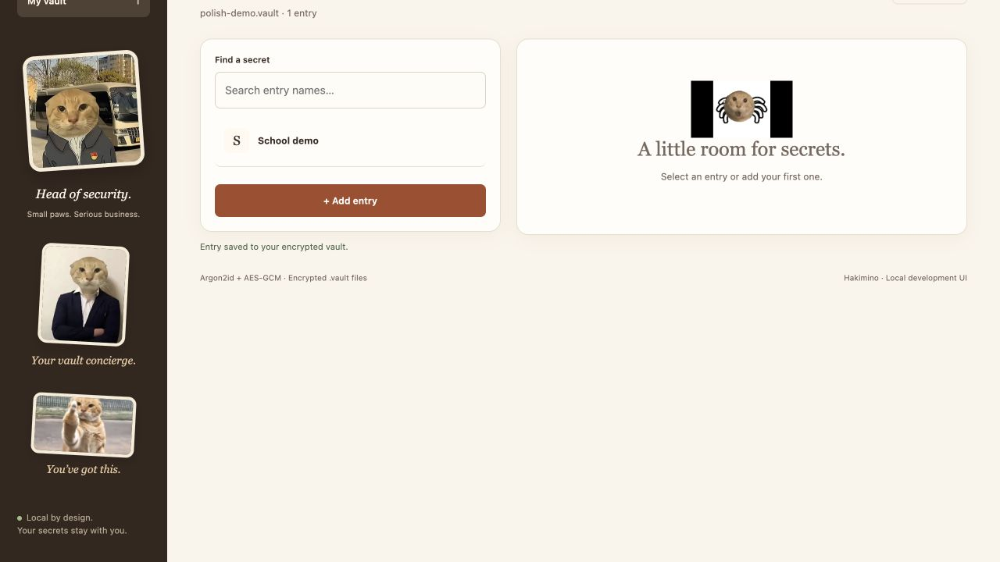
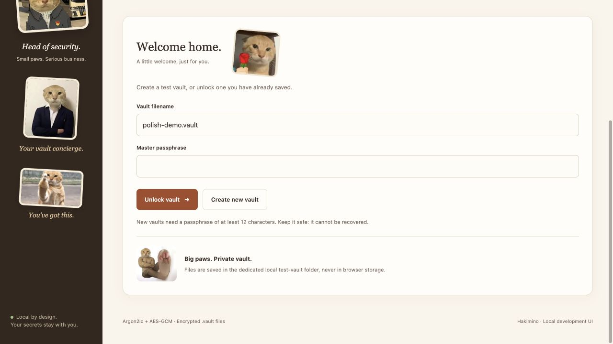

# Final web polish verification — 11 November 2026

## Change scope

Follow-up to `666ead44ab8b60b61bb25f44f57a55b75589d6c2`, delivered together
with the English demonstration script, earlier rehearsal report and evidence.
Only frontend behavior and its tests change; Python storage, cryptography,
CLI, desktop and the vault format are unchanged.

1. The workspace count now renders **0 entries**, **1 entry**, **2 entries**.
2. The current page remembers only the attempted/opened vault filename across
   lock, failed create/unlock, session expiry and connection failure. It does
   not retain a master passphrase or write to localStorage/sessionStorage.
   Reloading the page resets this page-local preference. Invalid input is HTML
   escaped before it is inserted into the filename attribute.
3. A different client's unlock does not replace the filename remembered by an
   old view. Existing unlock-epoch, ciphertext-revision and reveal guards remain.

## Tests actually run before commit

macOS 26.4 arm64; Python 3.12.14; Node 24.21.0. Synthetic data only.

| Check | Result |
| --- | --- |
| `python -m pytest -q -rs` | **93 passed**, no skips, 68.60 s ([log](evidence/web-polish-2026-11-11/pytest.log)) |
| `node --test tests/web_reveal.test.cjs` | **31 passed**, zero failures/skips ([log](evidence/web-polish-2026-11-11/node.log)) |
| `python -m pip check` | No broken requirements ([log](evidence/web-polish-2026-11-11/pip-check.log)) |
| `python scripts/verify_cli.py` | **12 real CLI process checks passed**, temporary vaults removed ([report](evidence/web-polish-2026-11-11/cli.log)) |
| Browser: zero/one records | Observed `0 entries`, then `1 entry` after saving synthetic School demo |
| Browser: explicit lock | Filename remained `polish-demo.vault`; master field empty |
| Browser: wrong passphrase and return to unlock | Error appeared; filename still `polish-demo.vault`; master field empty |
| Documentation and staging | English script/report updated; previous 18-test evidence kept historical; no real vaults or credentials included |

The 13 added frontend cases cover 0/1/2 counts, explicit lock, failed create and
unlock, different-client status, server expiry, network failure, successful
unlock selection, attribute escaping, password-field clearing on submission and
fresh-page default behavior. The minimal DOM tests are supplemented by the real
browser checks above; neither is claimed as a full cross-browser certification.

CI is run after push. Verify the exact submitted SHA in
[main Actions](https://github.com/GastonRicheal/hakimino/actions?query=branch%3Amain),
not the older `666ead4` run. No later CI outcome is fabricated in this pre-push
record. The separate final handoff message records the actual run result.

## Evidence screenshots

## Remaining acceptance boundary

Both known browser polish findings are resolved. The earlier rehearsal's actual
computer/projector and native file-dialog checks still require the team. The
five-minute and fifteen-second native timer results are the earlier real-duration
measurements for unchanged Python code, not newly repeated timings in this
frontend-only update. The full course brief and submission receipt remain outside
this technical verification. No claim of a perfect or production-certified
password manager is made.
